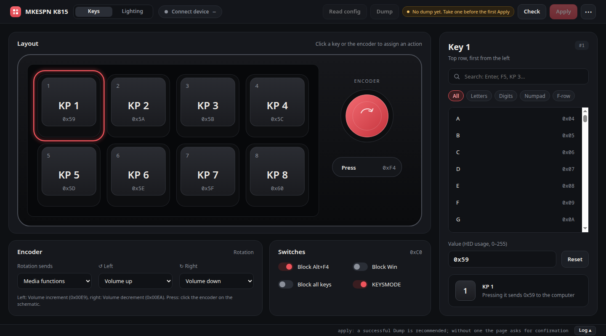
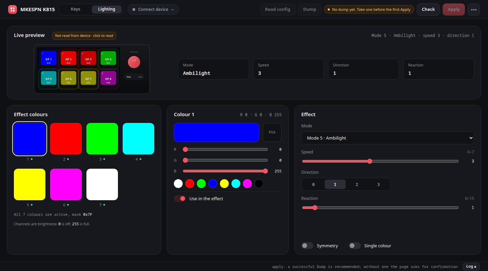

# MKESPN K815 — reverse engineering and a Linux/WebHID configurator

The MKESPN K815 is a small macro keyboard: 8 keys plus a rotary encoder (it is
shipped with the Windows-only *Gaming Keyboard* application). This repository
recovers the vendor HID protocol from that application and provides two
independent ways to configure the device without Windows:

* **`tools/k815ctl.py`** — a command-line tool for Linux (`hidraw`).
* **`webhid/`** — a single-page browser tool using WebHID (Chromium/Chrome).

Both speak exactly the same byte stream the vendor application sends: a full
upload session of **663 feature reports**, captured from the original `.exe`
running under Wine against a `uhid` device emulator.

> Status: verified on a real K815 (`30fa:2350`): 8-byte feature reports,
> memory reads, the full two-phase upload, key remapping from the CLI and the
> WebHID page, and recovery with the chip vendor's burning tool. The page ships
> the hardware session for the current `0x00E0` layout.

## Screenshots

| Keys | Lighting |
|---|---|
|  |  |

Taken at 1440×800 without a device connected. The layout fits without page
scrolling at 1440×800 and 1280×680; only the key list, the log and narrow
columns scroll.

## What can be configured

| Area | Details |
|------|---------|
| **Keys** | 8 keys + encoder press, mapped to USB HID usage codes (`F13..F24` work well as free hotkeys, see `KEYS.md`) |
| **Lighting** | 7-colour palette, 9 vendor-visible effect modes with speed, direction, symmetry, single-colour, reaction and an active-colour mask (hidden effect numbers are not offered; see `docs/KNOWN-LIMITATIONS.md`) |
| **Switches** | `BALTF4`, `BWINLOCK`, `BALLKEYSLOCK`, `KEYSMODE` — four options in one byte |
| **Encoder** | Rotation: 17 Consumer-page functions, or a single-key keyboard macro (the only way it can send an ordinary key). Press: a normal keymap slot |
| **Macros** | Factory shortcuts Cut/Copy/Paste/Boss/SelectAll (protocol recovered, not editable in the tools yet) |
| **Backup** | Dump the device memory and restore an exact known-good frame stream |

Macros are understood for the factory `ShortcutMacro` group: assigning Cut,
Copy, Paste, Boss or SelectAll to a key writes a per-key marker, a `MACRO_MAP`
slot and a 16-byte record that encodes one shortcut (Ctrl+X / Ctrl+C / Ctrl+V /
Win+D / Ctrl+A). The CLI and the WebHID page do **not** expose macro editing
yet; they keep the macro area of the template unchanged. See `PROTOCOL.md`.

## Working preset: free keys, encoder keys, no media

`presets/k815-f13-20-encoder.json` is the configuration verified on the unit:

| Control | Sends |
|---------|-------|
| 8 keys | `F13..F20` (`0x68..0x6F`) |
| Encoder left | Keypad `-` (`0x56`) |
| Encoder right | Keypad `+` (`0x57`) |
| Encoder press | `F21` (`0x70`) |

The rotation directions use **single-key macro records** (`01 00 86 <usage> 06 <usage>`)
instead of media functions, so the media layer is not involved. The press is the
keymap slot 49; rotation does not use keymap slots 41/49.

In WebHID the **Encoder** card has a `Rotation sends` switch (`Media functions` /
`Keyboard keys`), a key selector for each direction, and a separate
`Encoder press` selector. Switching between media and keyboard rewrites the
whole 16-byte record, so either direction can be changed without the CLI.

```sh
python3 tools/k815ctl.py apply presets/k815-f13-20-encoder.json
python3 tools/k815_reset.py       # or use the page Apply, which resets automatically
python3 tools/k815ctl.py show     # keymap, encoder records, function table
```

The same records can be written without a preset:

```sh
python3 tools/k815ctl.py encoder --macro enc0=0x56 --macro enc1=0x57
python3 tools/k815_reset.py
```

`F13..F20` are only plain keys if the xkb override is active; see `KEYS.md` and
`tools/install_fkeys_xkb.sh`.

## Requirements

* Linux with `/dev/uhid` (for the emulator) and `/dev/hidraw*` (for real use).
* Python 3.9+ — the CLI and all tools are stdlib-only.
* Chromium or Chrome — for the WebHID page.
* Optional: `node` (JS-vs-Python selftest), `Xvfb`, `xdotool`, `chromium`
  (end-to-end test), `innoextract` + Wine (re-capturing from the vendor app).

## Quick start: browser (WebHID)

```sh
python3 tools/serve_webhid.py     # http://127.0.0.1:8765/webhid/
```

Open the URL in Chromium/Chrome and press **Connect device**. WebHID requires a
secure context, so use `localhost` — opening `index.html` as a file will not
work.

If the device is not listed in the chooser, the vendor interface (usage page
`0xFF01`) is not accessible to your user. Install the udev rule (needs root,
run it yourself) and replug the keyboard:

```sh
sudo sh tools/install_udev.sh
python3 tools/k815ctl.py list      # should show two interfaces
```

The same rule also grants the local server access to the USB device node, which
the optional automatic reset uses after a write.

Then assign keys by clicking the schematic, edit lighting/switches/encoder, use
**Check** to see how many bytes would change, **Dump** to read the device
memory, and **Apply** to write.

## Quick start: command line

```sh
# see what is connected
python3 tools/k815ctl.py list
python3 tools/k815ctl.py info

# read the device memory (read-only)
python3 tools/k815ctl.py dump --addr 0 --length 0x190
python3 tools/k815ctl.py dump --json dump.json --config-base 0xE0 --record-base 0x248
python3 tools/k815ctl.py dump --preset current.json --config-base 0xE0 --record-base 0x248

# turn a saved dump into a preset (page JSON carries configBase/recordBase)
python3 tools/k815ctl.py preset --from-dump k815-memory-*.json --out current.json
python3 tools/k815ctl.py preset --from-dump dump.bin --base 0 \
    --config-base 0xE0 --record-base 0x248 --out current.json

# export the current state as a JSON preset, edit it, apply it
python3 tools/k815ctl.py preset --out my.json
python3 tools/k815ctl.py apply my.json --dry-run
python3 tools/k815ctl.py apply my.json

# individual edits (all support --dry-run)
python3 tools/k815ctl.py switches --set altF4=0 --set winLock=1
python3 tools/k815ctl.py encoder --list
python3 tools/k815ctl.py encoder --set enc0=3 --set enc1=5
python3 tools/k815ctl.py encoder --macro enc0=0x56 --macro enc1=0x57
python3 tools/k815ctl.py led --list
python3 tools/k815ctl.py led --mode 7 --speed 2 --color 1=FF0000
python3 tools/k815ctl.py keymap --keymap KBconfig.ini

# inspect a captured session: keymap, LED, switches, encoder and the 22-entry table
python3 tools/k815ctl.py show --template captures/baseline_apply.jsonl

# rollback safety net
python3 tools/k815ctl.py backup --out backup.json
python3 tools/k815ctl.py restore backup.json
```

A dump is a single memory image, unlike the two-phase upload stream. When it is
decoded into a preset the keymap comes from the phase-B copy at `0x0049`: the
later header and keymap writes overwrite parts of the phase-A copy at `0x0020`.
A dump with a bad SHA-256 or a gap is rejected instead of being filled with
zeros. The JSON written by `dump --json` is the same format the WebHID page
saves, so dumps move between the browser and the console unchanged.

Run the first write only after a `backup`: the artifact contains the exact,
known-good frame stream (plus a SHA-256), and `restore` replays it unchanged.

The preset JSON (version 3) is shared between the CLI and the WebHID page, so an
export from the browser applies through `k815ctl apply` byte for byte.

`keymap --keymap` accepts the 8×20 matrix format used by the vendor
`KBconfig.ini` (cells `A_B` → upload index `8*B + A`).

## Catching a non-arriving F-key

F13–F24 do reach the kernel, but the default evdev xkb rules remap them to
`XF86*` keysyms. The repository ships a user-level override:

```sh
sh tools/install_fkeys_xkb.sh          # install into ~/.config/xkb
sh tools/install_fkeys_xkb.sh --check
sh tools/install_fkeys_xkb.sh --remove
```

Details and the keycode table: `KEYS.md`.

## How it works

The vendor app talks to the device exclusively through **numbered HID feature
reports** (report ID `0x07`). The real keyboard declares a 7-byte payload
(8 bytes with the ID); the emulator used for the first capture declared 15
(16 with the ID), so the tools keep 16-byte frames internally and truncate
them on the wire. No driver, no interrupt transfers:

```
Windows: HidD_SetFeature / HidD_GetFeature
Linux:   /dev/hidraw + HIDIOCSFEATURE / HIDIOCGFEATURE
Web:     WebHID sendFeatureReport(7, payload) / receiveFeatureReport(7)
```

The protocol was recovered without hardware by registering a fake device on
`uhid` (`tools/k815_emulator.py`) and running the original application under
Wine against it. Every `HidD_SetFeature` call is logged, so the exact bytes are
known. One Apply press is a two-phase session:

* **phase A** — the keymap at `0x0020`, a service block at `0x00D0`, then a
  verify read of `0x0001`;
* **phase B** — the header/switches/LED at `0x0001`, the keymap again at
  `0x0049`, Fn actions, and the encoder/function record table from `0x00F9`.

On a real device phase B moves with the config base reported in the info
answer (`base+0x00`, `base+0x48`, `base+0xF8`, `base+0x168`); see
`PROTOCOL.md`.

Both phases intentionally write different values to the same addresses, so the
tools do not rebuild the session from scratch: they take a verified captured
template and patch only the data bytes for the keymap, LED, switches and
encoder. This is why the output matches the vendor application exactly. The
function/record table at `0x00F9` is left as captured: assigning a macro is
understood, but the tools do not edit that area yet (`k815ctl show` prints it).

`webhid/k815_session.js` is generated from the hardware session
(`tests/fixtures/hw_apply_e0.jsonl.gz` by default) by `tools/build_webhid.py`;
the patch targets are relative to the config base, so the same page works on
the `0x00E0` layout. Regenerate it after a new capture.

## Hardware verification and recovery (November 2026)

The first real unit (`30fa:2350`) confirmed the transport and exposed the
differences from the emulator capture:

* the real HID descriptor declares a **7-byte feature report** (8 with the
  ID); the emulator capture used 16 bytes, so the `flag` byte at offset 14
  never reaches hardware;
* phase B is written at the **config base reported in the info answer**. The
  factory base was `0x0118`; after the chip vendor's burning tool it is
  `0x00E0`. The phase-A addresses (`0x10`, `0x20`, `0xD0`) do not move;
* a memory read is `READ` (`07 18 05`), a 1 ms pause, `GET_FEATURE` (byte 1 is
  the data) and the closing `07 18 01`; the first two answers after INIT are a
  stale buffer.

A first write with the emulator-sized 16-byte reports corrupted the identity
area, and the unit came back as `30fa:2360 USB Keyboard` in standard mode. The
chip vendor's **IST83025B burning tool** (`KB_Config.exe`, from
`20240819112054.zip`) restored the `30fa:2350` identity, the `MKESPN` product
info and game mode. Its layout uses base `0x00E0`; the repository ships both
captured sessions and the tools pick the one matching the base the device
reports.

The current hardware template is `tests/fixtures/hw_apply_e0.jsonl.gz`. After a
verified write, the WebHID page closes the HID handle; this firmware also needs
a real USB re-enumeration, which `tools/serve_webhid.py` performs through
`POST /reset` (`USBDEVFS_RESET`) once the USB udev rule is installed.

## Repository layout

```
tools/
  k815_proto.py        protocol model: frames, sessions, block patching, LED, encoder,
                       22-entry function table, dump decoding
  k815ctl.py           CLI over k815_proto
  k815_emulator.py     fake uhid device that logs traffic and serves fake memory
  app_capture.sh       run the vendor .exe under Wine and capture one Apply
  sweep_config.py      sweep config.ini fields -> address/value map
  build_webhid.py      capture -> webhid/k815_session.js
  selftest_cli.py      offline model/CLI checks (no browser, no hardware)
  selftest_webhid.py   JS driver vs Python reference
  e2e_webhid.py        Chromium -> WebHID -> hidraw -> uhid end-to-end test
  run_all.sh           all checks in one command
  install_udev.sh      /dev/hidraw access for the session user
  install_fkeys_xkb.sh restore real F13..F24 keysyms
  led_modes.json       measured effect number -> name table
  media_table.py       encoder media function table
  udev/, xkb/          config files used by the installers
webhid/
  index.html           markup + device schematic (inline SVG)
  style.css            theme and responsive layout
  app.js               UI logic, sending, verification, dump, import/export
  k815.js              driver: constants, usage codes, device selection, ini parser
  k815_session.js      generated session template (663 frames + delays)
docs/
  README.md            documentation index
  HARDWARE.md          controller, USB descriptors, LED topology, encoder
  KNOWN-LIMITATIONS.md polling, encoder dropouts, per-key limits, speed, OpenRGB
captures/              recorded traffic (gitignored)
extracted/             unpacked vendor app (gitignored)
tests/
  fixtures/            committed inputs for the offline suite (see below)
  make_fixtures.py     regenerate the fixtures from captures/ + extracted/
```

## Capturing from the vendor application (optional)

The artifacts are not committed. To reproduce them:

```sh
# 1. unpack the installer
innoextract -d extracted "MKESPN K815.EN[20250610].exe"

# 2. terminal 1: emulator
python3 tools/k815_emulator.py --log captures/session1.jsonl

# 3. terminal 2: the app itself
cd extracted/app
WINEPREFIX=~/.wine-k815 wine "Gaming Keyboard.exe"
```

`tools/app_capture.sh <out.jsonl>` automates the run: it copies the given
`config.ini` / `ShortcutMacro.dat` / `KBconfig.ini`, clicks through the UI
(including the key-assignment dialog), presses Apply and writes the capture.
`tools/sweep_config.py` builds on it to map `config.ini` fields to addresses.

## Tests

```sh
sh tools/run_all.sh          # syntax checks + both offline selftests
sh tools/run_all.sh --full   # plus the Chromium end-to-end test
```

The suite needs no real keyboard **and no uncommitted artifacts**: the offline
tests fall back to the compact fixtures in `tests/fixtures/` (gzipped reference
and macro sessions, the factory keymap and a seed `config.ini`). If `captures/`
or `extracted/` are present they take precedence, so a new capture can be tested
by dropping it in. Regenerate the fixtures with `python3 tests/make_fixtures.py`
after unpacking the vendor app. The end-to-end test drives the `uhid` emulator.
Missing optional tools are reported as skipped, not failed.

Individual checks:

```sh
python3 tools/selftest_cli.py      # CLI SELFTEST PASS (63/63)
python3 tools/selftest_webhid.py   # WEBHID SELFTEST PASS (node required)
python3 tools/e2e_webhid.py        # E2E WEBHID PASS (Xvfb :99 + chromium + xdotool)
```

The end-to-end test walks the real flow: a click in the page → JS frame assembly
→ Chromium WebHID → the kernel → `uhid` → the emulator log, compared byte for
byte with `tools/k815_proto.py`.

## Limitations

The full list, with the hardware reasons, is in
[`docs/KNOWN-LIMITATIONS.md`](docs/KNOWN-LIMITATIONS.md). The most important
ones:

* **100 Hz polling.** Both HID interrupt endpoints declare `bInterval = 10 ms`
  on USB 1.1 low-speed. Fast key/encoder events inside one 10 ms window can be
  lost; there is no polling setting in the firmware.
* **Encoder dropouts.** Rotation in keyboard mode is a single-key macro with
  key-down/key-up back-to-back and no delay; a quick spin loses detents. Media
  functions may be more reliable. No scan rate or hold-time setting exists.
* **No per-key lighting.** One 7-colour palette and one global effect; the ASIC
  renders all keys. OpenRGB is realistic only for the global palette/effect, not
  per-key.
* **Reads stop the keyboard.** After a memory-read batch the firmware stops
  sending normal input; the page sends the closing `INIT` + `COMMIT` handshake.
  A USB bus reset is not a power cycle.
* **Slow config I/O.** About 20 ms per byte, ~4.8 s for the 225-byte page
  (single pass). There is no block-read command.

Other limitations:

* **Hardware layout depends on the unit's config base.** The factory layout
  used `0x0118`; a unit configured with the chip burning tool reports `0x00E0`.
  `k815ctl` and the WebHID page select the matching captured session
  (`tests/fixtures/hw_apply*.jsonl.gz`) from the info answer.
* **Automatic USB reset needs a udev rule.** Closing the HID handle is not
  enough for this firmware: it applies a new keymap after USB re-enumeration.
  `tools/serve_webhid.py` does that through `POST /reset`, but only after
  `sudo sh tools/install_udev.sh` grants access to `/dev/bus/usb/...`;
  otherwise the page asks for one replug.
* **The browser end-to-end test skips when a physical K815 is connected.** The
  emulator and the real device share VID/PID `30fa:2350`, so Chromium's chooser
  cannot reliably select the emulator. Unplug the keyboard to run the emulator
  test; the real hardware is tested by the page and the CLI.
* **Dump and restore are asymmetric on hardware.** Reading the whole image
  works, but a dump records the active config bank (`0x0118` on the factory
  layout, `0x00E0` after the burning tool), while the upload stream writes the
  two phases; `restore` replays a captured frame stream, not a memory image.
  Keep the artifact from `backup --from-device`.
* Macro assignment is not editable in the CLI/WebHID yet: the protocol is
  documented (per-key markers, `MACRO_MAP` slots, 16-byte shortcut records),
  but the tools only replay the template's macro area.
* Text macros and custom macro groups are still open; a custom single-letter
  macro produced no record in the vendor application.
* Media functions can be put on the 8 keys by the vendor application (the
  keymap value is `0xC9 + n`), but the CLI and the page do not expose that yet:
  they assign media functions to encoder rotation only.
* The whole session is sent at once; there are no incremental writes.
* The PID pair is confirmed on hardware (`30fa:2350`); the other candidates in
  the udev rule stay commented out.
* WebHID works only in Chromium-based browsers.

## Documentation

| File | Contents |
|------|----------|
| `docs/README.md` | documentation index |
| `docs/HARDWARE.md` | controller (IST83025B/K201), USB descriptors, LED topology, encoder, identity recovery |
| `docs/KNOWN-LIMITATIONS.md` | polling, encoder dropouts, per-key limits, read/write speed, input hang, OpenRGB feasibility |
| `PROTOCOL.md` | transport, report format, session layout, memory map, keymap and LED encoding |
| `RE-NOTES.md` | what is inside the installer and the application, UI click map |
| `PLAN.md` | the work plan and what each stage proved |
| `KEYS.md` | reassigning keys, F13–F24 as hotkeys, the xkb pitfall |
| `CHANGELOG.md` | release history |
| `webhid/README.md` | the browser tool in detail |

## Disclaimer

Unofficial project. Not affiliated with MKESPN or Wuxi Instant
Microelectronics. The protocol was recovered for interoperability. Writing a
malformed session can corrupt the controller's identity area; keep a dump and
the vendor's burning tool at hand. No warranty, use at your own risk.

## License

MIT. See [LICENSE](LICENSE).
